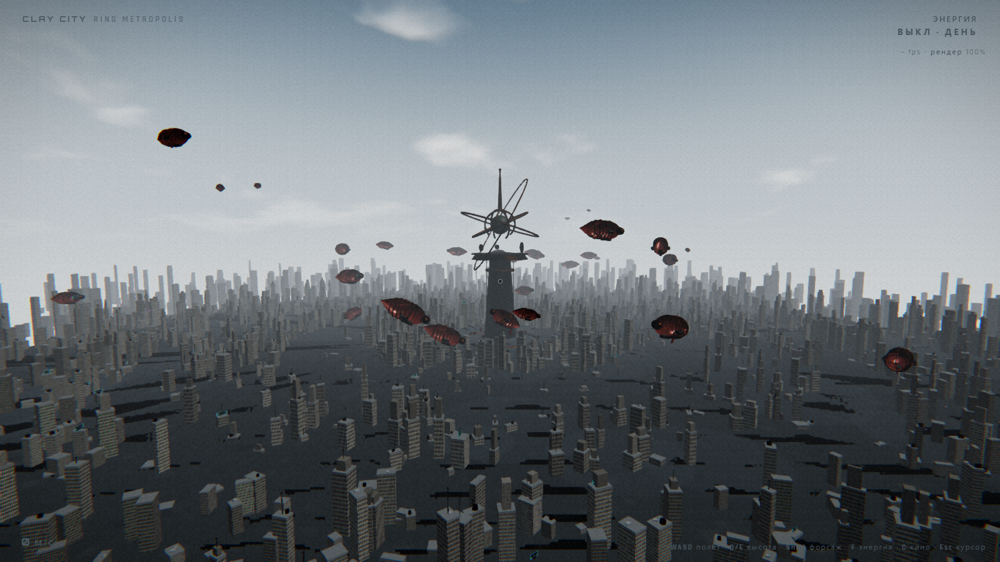
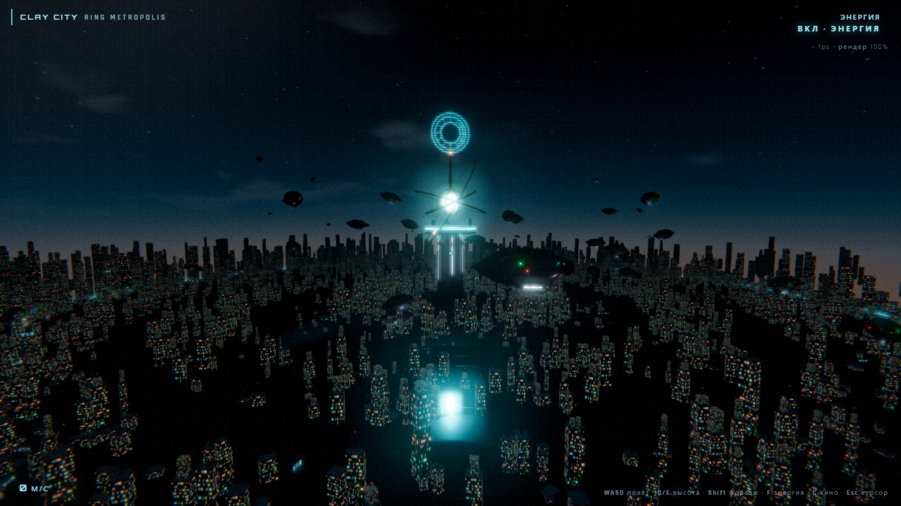

# CLAY CITY — Neon & Brass

Кинематографичный **киберпанк-стимпанк** мегаполис на Three.js в реальном времени:
кольцевой город на платформах, жёсткие дирижабли с латунными рёбрами, центральный
реактор с голограммой, объёмные прожекторы, пар, угольки, туман и кино-постобработка.

**Живое демо:** https://tagiriskaliev18-hash.github.io/clay-city/

| День (пасмурный реализм) | Ночь (энергия города) |
| --- | --- |
|  |  |

## Управление

| Клавиша | Действие |
| --- | --- |
| **W A S D** | полёт |
| **Мышь** | обзор (клик — захват курсора) |
| **Q / E** | снижение / набор высоты |
| **Shift** | форсаж (с FOV-киком) |
| **F** | день / энергия города (плавный переход ~2.6 c) |
| **C** | кино-режим: камера-дрон летит по маршруту, letterbox-кадр. Любая клавиша движения — выход |
| **Esc** | отпустить курсор |

## Что под капотом

- **index.html + ES-модули** (`src/`), без сборки — GitHub Pages работает как есть.
  Three.js 0.170 через importmap с CDN.
- **Процедурные PBR-текстуры** (canvas): фасады 1024px с окнами/потёками/рамами,
  латунь и сталь с заклёпками, обшивка дирижаблей, мокрый асфальт с roughness-картами.
  Никаких внешних файлов — всё генерируется при загрузке.
- **World-scale UV для фасадов** (патч шейдера через `onBeforeCompile`): окна на всех
  зданиях одного метража, узор не повторяется — джиттер по `gl_InstanceID`.
- **Инстансинг везде**: ~6200 зданий + крыши + короны, крышный «мусор» (баки,
  кондиционеры, антенны с маячками), трафик (1500 машин), мосты, шестерни-тотемы,
  вывески-лезвия. Полный кадр: **~175 draw calls / ~0.65 млн треугольников**.
- **Дирижабли**: жёсткий корпус (LatheGeometry) с тонкими латунными рёбрами, гондола
  с лентой окон, мотогондолы с вращающимися винтами, носовой латунный конус, хвостовое
  оперение, бортовые огни (красный/зелёный) и **строб-огни** с фазой по инстансу
  (шейдер). Едут по замкнутым CatmullRom-маршрутам: **крен в поворотах** (v²/g·R),
  килевая и бортовая качка, ветровой дрейф, паровые следы из мотогондол (CPU-пул
  частиц). Два «героя» с **объёмными прожекторами** + реальными SpotLight,
  освещающими улицы.
- **Небо-шейдер**: трёхслойный градиент, солнце/луна, fbm-облака, звёзды с мерцанием,
  засветка города у горизонта. Из него же пекутся **PMREM-окружения** для PBR-отражений
  (латуни, стекла, мокрого асфальта).
- **Переход день↔ночь** анимирует всё: небо, туман, свет, экспозицию, env-интенсивность,
  эмиссию окон/вывесок/трафика, грейдинг, зерно, виньетку, аберрацию.
- **Постобработка**: UnrealBloom (полрез) → OutputPass (ACES) → cine-pass (грейдинг в
  тенях, S-контраст, хроматическая аберрация, зерно, виньетка) → FXAA; MSAA×4 на
  render-target в WebGL2.
- **Частицы на GPU**: угольки, уличный пар (замкнутый цикл в vertex-шейдере), листы
  дымки с fbm-альфой.
- **Адаптивное качество**: FPS-метр в HUD, авто-масштаб рендера 55–175% (у RTX 3070
  держит 60+ fps с запасом; на слабых iGPU картинка остаётся стабильной).

## Отладочные параметры URL

`?autostart` — сразу в полёт · `&day=1` / `&lit=1` — форсировать режим ·
`&cine=1` — стартовать в кино-режиме · `&t0=40` — сдвиг времени ·
`&cam=x,y,z&look=x,y,z` — постановочная камера · `&msaa=0`, `&noenv=1`,
`&nocity=1`, `&noair=1`, `&nopart=1`, `&nosky=1`, `&nocentral=1` — отключать
подсистемы · `&debug=1` — статистика кадра в консоль.

## Запуск локально

```bash
# из корня репозитория (нужен статический сервер из-за ES-модулей)
npx serve .          # или: python -m http.server
```

## Структура

```
clay-city/
├── index.html          # оболочка: HUD, загрузка, importmap
├── src/
│   ├── main.js         # сборка сцены, переход день/ночь, цикл, адаптив
│   ├── config.js       # палитры DAY/NIGHT, константы мира, MODE
│   ├── textures.js     # процедурные canvas-текстуры
│   ├── materials.js    # PBR-материалы + реестры режимов + facade-патч
│   ├── sky.js          # шейдерный купол (день/ночь/звёзды/облака)
│   ├── city.js         # кольца, здания, вывески, трафик, мосты, шестерни
│   ├── central.js      # центральная башня: реактор, лифты, корона
│   ├── airships.js     # флот дирижаблей и их «физика» полёта
│   ├── particles.js    # угольки, пар, следы, дымка
│   ├── effects.js      # композер постобработки
│   └── controls.js     # полёт + кино-режим
├── assets/             # превью для README
└── .gitignore
```

История: v1 была «clay-render» прототипом (серый макет из боксов, 110 дирижаблей
на круговых орбитах). В v2 стиль эволюционировал в киберпанк-стимпанк с упором на
реализм: PBR-материалы, кинематографичный свет и постобработка, а движение
дирижаблей переписано с механических кругов на живые маршруты с кренами и качкой.
