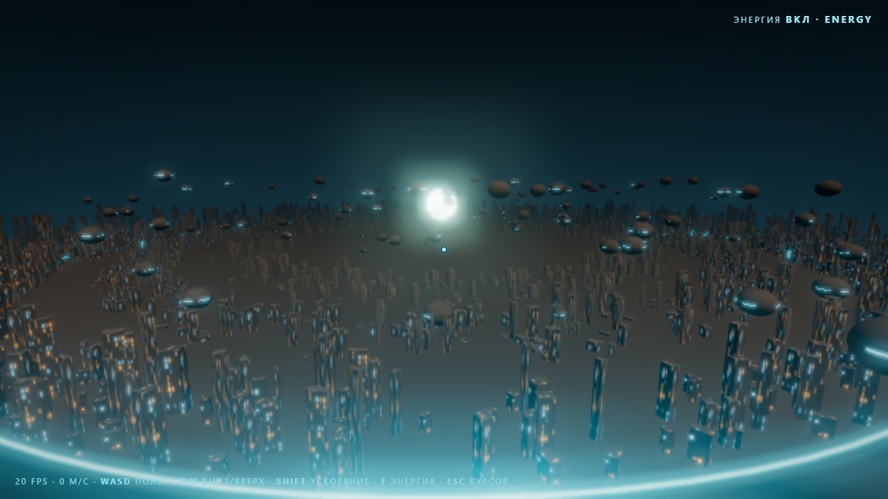

# Clay City

A flyable clay-render sci-fi megacity in the browser. Drift between floating ring
platforms and glowing airships — then press **F** and watch the whole gray clay
world power on into a teal-lit night metropolis.

**Live demo:** https://tagiriskaliev18-hash.github.io/clay-city/



## Controls

| Key | Action |
|---|---|
| `W A S D` | fly |
| Mouse (click to capture) | look around |
| `Q` / `E` | descend / climb |
| `Shift` | boost |
| `F` | toggle city energy (clay ↔ lit) |
| `Esc` | release cursor |

## How it's built

- **One HTML file**, no build step. Three.js r170 loaded from jsDelivr via an
  import map (network connection required on first load).
- **Procedural kitbash city**: ~6,500 buildings on four concentric ring platforms
  plus ~2,200 silhouette towers on the horizon, all in two `InstancedMesh` draws
  with per-instance gray-value variation. No textures anywhere — the whole look
  is geometry, fog and light.
- **Airships**: 110 instanced zeppelins — lathe-geometry hulls (elliptical nose →
  cylinder → tapered tail) with cruciform tail fins, ventral gondolas and 48
  emissive dotted lights each (midship band + two meridian strips). Four draw
  calls for the whole fleet; hulls darken when the city powers on.
- **Clay → energy transition** is a single 0→1 scalar driving fog color/density,
  background, hemisphere/directional light color and intensity, emissive
  intensity, bloom strength/threshold and a central point light — all lerped
  per frame, so the world crossfades live instead of swapping presets.
- **Cables**: 500+ sagging quadratic-bezier line segments strung between ring
  anchor points.
- Runs at 200+ FPS on a mid-range desktop GPU (measured at 1080p).

Inspired by clay-render sci-fi loops by [nichenovus](https://www.instagram.com/nichenovus/)
(made in Blender Eevee); this is an original real-time recreation of that style,
not affiliated with the artist.

## Run locally

```bash
python -m http.server 8137
# open http://localhost:8137
```

Any static server works; opening `index.html` directly from disk also works in
Chrome/Edge because all imports are remote HTTPS modules.

## Structure

```
clay-city/
├── index.html          # the whole game (markup, styles, JS)
├── assets/             # README preview screenshots
└── .gitignore
```
